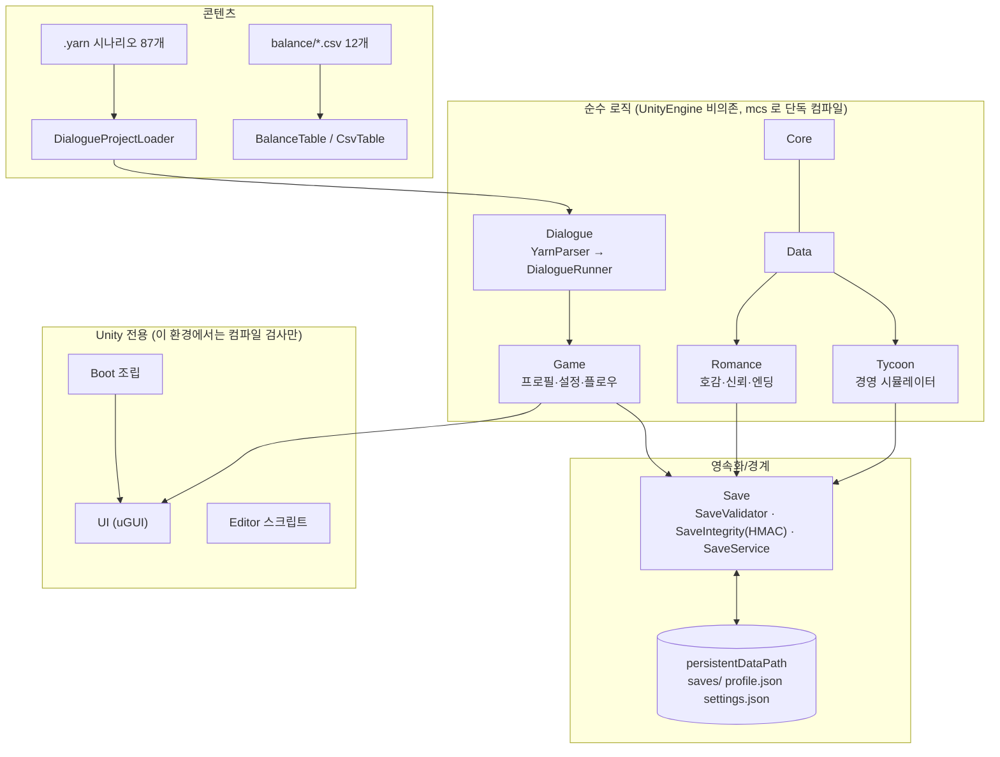

# 달빛 모퉁이의 수인들 (Moon Corner House) — 프로젝트 개요

> **한 줄 요약**: 수인 카페 타이쿤 + 연애 비주얼 노벨(Unity 6, 싱글 플레이·오프라인)을 만들면서, **무수집 개인정보 설계 · 세이브 무결성/검증 · 비신뢰 입력 파서 방어 · 공급망(SBOM)·출처 기록**을 설계하고, 직접 만든 퍼징 하네스로 검증해 **실제 결함 8건(전부 수정)을 찾아 정리**한 포트폴리오 프로젝트입니다.
> **English**: A Unity-based single-player furry café-tycoon + romance visual novel, used as a vehicle to practice privacy-by-design (no accounts/telemetry), save-file integrity and validation, hardening a custom script parser against untrusted input, SBOM/provenance tracking, and a seeded fuzzing harness. It is a game, not a production security product; limits are documented in `SECURITY_DESIGN.md` §10.

> **정직한 상태 표시** — 이 저장소의 자동 검증은 *Unity 없이 가능한 범위*(순수 C# 로직, 컴파일 가능성, 데이터·시나리오 정합성)입니다. Unity 에디터 안에서의 빌드·렌더링·입력, Unity 에디터 스크립트, NUnit 24개 테스트는 **아직 실행하지 못했습니다**(`docs/17_Test_Plan.md`). 일러스트·음악은 제작 전(플레이스홀더)입니다.

---

## 1. 무엇인가

| 항목 | 내용 |
|---|---|
| 장르 | 수인 타이쿤 + 연애 시뮬레이션(비주얼 노벨) · 전연령(암시적 표현까지) · 성인 캐릭터 한정 |
| 엔진/언어 | Unity 6 LTS · C#. 로직은 UnityEngine 비의존 순수 C# 으로 분리해 Unity 없이 시험 |
| 구성 | 경영(8챕터 64일) + 공략 대상 6인 × 루트/엔딩, 공동 루트, 대사 엔진(자체 구현 "MiniYarn"), 세이브·프로필·설정, UI |
| 설계 문서 | `docs/00_GDD.md` … `docs/17_Test_Plan.md`, 법무·출처 초안 `docs/legal/` |

## 2. 규모 (실측 — 재현 명령은 `EVIDENCE_INDEX.md`)

> 코드가 계속 늘고 있어 아래 값은 **2026-10-03 측정 시점의 스냅샷**입니다. 제출 직전에 같은 명령으로 다시 측정해서 바꾸세요.

| 지표 | 값 | 측정 방법 |
|---|---|---|
| C# 소스(런타임+에디터, `Scripts/`) | **102 파일 / 16,111 줄** (에디터 스크립트 797줄 포함) | `find UnityProject/Assets/_Project/Scripts -name '*.cs' \| xargs cat \| wc -l` |
| Unity EditMode 테스트 코드 | 3 파일 / 567 줄 / `[Test]` **24개** (**미실행**) | `grep -c "\[Test\]" .../Tests/EditMode/*.cs` |
| 검증 하네스(C#, `tools/`) | 13 파일 / 5,489 줄 (보안 자가 테스트 포함) | `find tools -name '*.cs' \| xargs cat \| wc -l` |
| 도구 스크립트(py/sh) | 1,434 줄 | `tools/*.py`, `tools/*.sh` |
| 시나리오(`.yarn`) | **87 파일 / 9,085 줄 / 178 노드** | `find .../Dialogue -name '*.yarn'` |
| 시나리오 분량(하네스 보고) | 대사·지문 **4,562줄**, 선택지 **544**, 약 5.6만 어절 | `sh tools/csharp_check/scenario_check/run.sh` |
| 문서 | `docs/*.md` + `docs/legal/*.md` 28개 / 3,590 줄 | `cat docs/*.md docs/legal/*.md \| wc -l` |
| **순수 로직 하네스 검사 수** | **958** = 16 + 46 + 302 + 140 + 186 + 169 + 99 (전부 PASS, 실패 0) | 아래 표 |
| **보안 자가 테스트** | **35,154 반복/케이스**, 약 85초, 고정 시드 (발견 8건 전부 수정·회귀 시험, 종료 코드 0) | `sh tools/security_selftest/run.sh` |
| 릴리스 점검(빠른 모드) | PASS 15 / WARN 1 / SKIP 2 / FAIL 0 | `sh tools/release_check.sh --fast` |

| 하네스 | 검사 수(직접 실행 확인) | 대상 |
|---|---|---|
| `tools/csharp_check/run.sh` | 16 | 경영 시뮬레이터, 세이브 왕복·변조 탐지·백업 복구 |
| `…/romance_check/run.sh` | 46 (+몬테카를로 패리티) | 호감/신뢰/엔딩 규칙 |
| `…/dialogue_check/run.sh` | 302 | 대화 엔진 파서·실행·린트·스트레스 |
| `…/ending_check/run.sh` | 140 | 엔딩·공동 루트·저장 호환 |
| `…/flow_check/run.sh` | 186 | 챕터 흐름·프로필·루트 선택 |
| `…/ui_logic_check/run.sh` | 169 | 프로필 검증·VN 상태·설정·시나리오 전수 실행 |
| `…/scenario_check/run.sh` | 99 | 전체 `.yarn` 린트·도달성·**1,595,664회 실행 오류 0** |

## 3. 아키텍처

설계 규칙(`docs/01_TechDesign.md` §4): 모듈 간 통신은 이벤트 버스/인터페이스, 어셈블리 정의(`*.asmdef` 12개)로 의존 방향을 강제, 상태 변경은 도메인 서비스만.

## 4. 보안·개인정보 관점의 설계

> 목적: "정보보호 직무 지원자가 **자기 프로젝트에 위협 모델링·통제·검증·한계 인정**을 일관되게 적용했는가"를 보여주는 것. 게임이라 상용 수준의 방어를 주장하지 않습니다.

| 주제 | 설계/구현 요약 | 증거 파일 | 한계(정직) |
|---|---|---|---|
| **개인정보 무수집** | 계정·텔레메트리·광고·네트워크 코드 없음. 저장 데이터는 주인공 이름·성별 선택·종족 선택·진행 정보뿐이고 로컬에만 존재 | `docs/01_TechDesign.md` §11, `docs/legal/PRIVACY_POLICY_DRAFT.md`, `SECURITY_DESIGN.md` §8, 확인: `grep -rn "UnityWebRequest\|HttpClient\|System.Net\|Analytics" UnityProject/Assets` → 0건 | 빌드 결과물의 실제 권한 목록은 미확인(Unity 필요). 처리방침은 **초안**(`[TODO]` 남음, 법률 검토 전) |
| **세이브 무결성** | HMAC-SHA256 서명 + 상수 시간 비교, 원자적(임시 파일→교체) 저장 + `.bak` 복구, 저장은 아침 단계만 | `Scripts/Save/SaveIntegrity.cs`, `SaveService.cs`, `SaveMapper.cs` | **키가 클라이언트에 있어 의지 있는 변조는 막지 못함**(문서화). 목적은 우발적 손상·단순 편집 탐지 |
| **입력 검증** | 로드한 데이터의 범위·형식·크기 검증(난이도·챕터·골드 등, `NaN/Infinity` 거부, 리스트·문자열 길이 상한) | `Scripts/Save/SaveValidator.cs`, 시험: `tools/security_selftest/` | 일부 필드 미검증(F-7). 서명된 위조 파일 4,892건 거부 확인 |
| **경로 조작 방지** | 파일명은 정수 슬롯에서만 생성(`slotN.json`), 저장소는 `Path.GetFileName` 사용 | `SaveService.SlotName`, `FileSaveStorage.PathOf` | 자가 테스트가 **빈 이름일 때 폴더 바깥에 `.tmp` 생성**(F-1, 앱 경로로는 도달 불가) 발견 |
| **비신뢰 입력 파서** | `.yarn` 파서·표현식 언어를 닫힌 문법으로 구현, 줄 번호가 붙은 예외, 린트, 파일별 오류 격리 | `Scripts/Dialogue/YarnParser.cs`, `DialogueRunner.cs`, `DialogueLint.cs` | 재귀 깊이·점프 순환·거대 숫자 방어 미비(F-2~F-5). 번들 콘텐츠라 현재는 도달 불가 |
| **프로필/설정 로더** | 깊이 12 제한 JSON 파서, 폴백(빈 프로필), 항목 수·키 길이·값 범위 한도 | `Scripts/Game/MiniJson.cs`, `ProfileService.cs`, `Settings.cs` | 파일 크기 상한 없음(F-8) |
| **공급망·SBOM** | CycloneDX 1.5 SBOM 생성기 + 최신성 검사, 서드파티 고지 초안, 외부 엔진 의존 최소화(자체 대화 엔진) | `tools/generate_sbom.py`, `docs/legal/SBOM.cdx.json`, `THIRD_PARTY_NOTICES.md` | 구성 요소 10개 중 4개 버전 `unspecified`, 패키지 버전 미고정 |
| **빌드 무결성** | 소스 아카이브 결정적 tar + SHA-256, 빌드 후 `BUILD_INFO.txt`(해시·커밋·시각), 시크릿 휴리스틱 검사 | `tools/package_source.sh`, `Scripts/Editor/BuildTools.cs`, `tools/release_check.sh` | **코드 서명 없음**, `BuildTools.cs` 는 Unity 에서 미실행 |
| **AI 에셋 출처** | 점검표 + 기록 양식(`ai_assisted` 필드, 도구·모델·약관 확인 일자) | `docs/02_Art_Plan.md` §8, `docs/legal/AI_AND_RIGHTS_CHECKLIST.md`, `art_log.csv`(양식) | **기록은 아직 비어 있음** — 체계가 설계된 단계 |
| **검증 문화** | 7개 하네스(958 검사) + 컴파일 검사 + 릴리스 게이트 스크립트 + 퍼징 | `docs/17_Test_Plan.md`, `tools/release_check.sh`, `tools/security_selftest/` | Unity 측 미검증, 퍼징은 단순 변이 방식 |

바로 읽는 순서 추천: **`SECURITY_DESIGN.md`(위협 모델) → `SELFTEST_RESULTS.md`(검증과 발견) → `EVIDENCE_INDEX.md`(재현 명령)**.

## 5. 이 프로젝트로 보여줄 수 있는 것 / 없는 것

- 보여줄 수 있음: 위협 모델링(STRIDE), 입력 검증·안전한 실패(fail-safe), 무결성 vs 기밀성의 구분, 개인정보 최소화 설계, 퍼징·결함 보고(심각도·재현·패치안), 한계의 명시, 근거 파일과 재현 명령으로 뒷받침되는 문서화.
- **보여줄 수 없음**: 실제 서비스 운영·침해 사고 대응 경험, 서버/클라우드 보안, ISMS-P 심사 경험, 취약점 진단(모의해킹) 실무, 암호 구현의 전문성(표준 HMAC 사용만), 사용자·매출·인증 이력. 이런 항목은 쓰지 마세요.

## 6. 폴더 안내 (`portfolio/`)

| 파일 | 내용 |
|---|---|
| `README_PORTFOLIO.md` | (이 문서) 채용 담당자용 개요 |
| `SECURITY_DESIGN.md` | 자산·신뢰 경계·STRIDE 위협 모델·통제·시험·잔여 위험·개인정보 설계·PIA 체크리스트·한계와 로드맵 |
| `EVIDENCE_INDEX.md` | 주장 ↔ 파일 ↔ 재현 명령 ↔ 실측 결과 |
| `SELFTEST_RESULTS.md` | 보안 자가 테스트 결과와 발견한 결함(패치안 포함) |
| `RESUME_GUIDE.md` | 이력서·자기소개서·면접 준비 가이드 |
